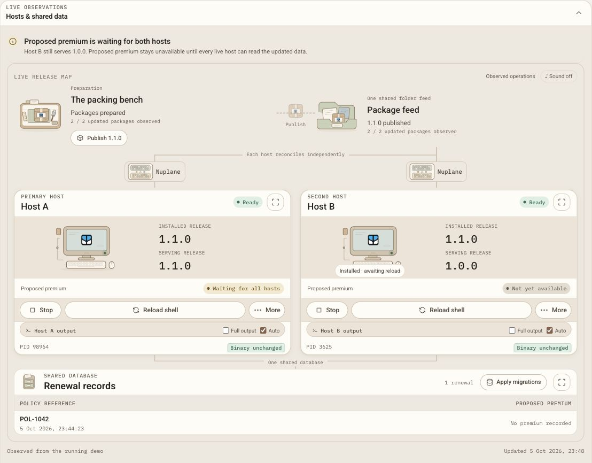

# Building Elsa 4 · Week 21: When Can a Fleet Write a New Schema?

*September 25–October 1, 2026*

Last week we gave operators tooling to apply and validate migrations. This week we asked what happens after a migration when two live hosts still run different module versions. Adding a column and teaching every live reader what a new row means are two different events. We built the protocol around the gap between them. [Accepted rollout decisions](https://github.com/elsa-workflows/elsa-foundation/pull/2118)

## Read ahead, then agree to write

The unit of rollout is a *schema family*, a group of persisted data that shares a format version. New code can read the old form through an upcaster, a conversion from one version to the next. Each host reports the versions it can read. Until the fleet finalizes the new version, current hosts still write the old format. Finalization waits for live members to advertise compatibility and can be held by an operator. After it, an old host that cannot read the finalized version refuses the module. That is the point at which simply rolling the code back stops being safe. [Rollout decisions](https://github.com/elsa-workflows/elsa-foundation/pull/2118), [Upcaster chain](https://github.com/elsa-workflows/elsa-foundation/pull/2141), [Finalization gate](https://github.com/elsa-workflows/elsa-foundation/pull/2145)

Placement has its own question. Can this host actually run the consumer the execution needs? A host may understand a stored row and lack the required active consumer. Claiming and failing over work therefore check the runtime capabilities a live member advertises. A feature that needs the new schema can stay dormant until finalization and, when it also needs old rows rewritten, until the backfill records completeness. [Version-aware placement](https://github.com/elsa-workflows/elsa-foundation/pull/2142), [Dormancy](https://github.com/elsa-workflows/elsa-foundation/pull/2147), [Backfill](https://github.com/elsa-workflows/elsa-foundation/pull/2154)

Imagine a feature that adds a searchable field to existing notes. A newer host can read an old note as soon as it has the converter. It can begin writing the new format after finalization. If the search is supposed to include notes nobody has touched since the upgrade, it also needs proof that the backfill finished. [Finalization and completeness decision](https://github.com/elsa-workflows/elsa-foundation/pull/2118), [Backfill protocol](https://github.com/elsa-workflows/elsa-foundation/pull/2154)

## Rehearse the change with a real package

We added two releases of a sample Notes module and a rehearsal for loading them through Foundation Host. The runbook includes the single-host scenario on SQLite and the in-place upgrade scenario on PostgreSQL. The same scenario later became the walkthrough in the [modules without a restart article](/blog/elsa-4-modules-without-restart). [Demo and rehearsal](https://github.com/elsa-workflows/elsa-foundation/pull/2171)

*In the Notes rehearsal, Host A has reloaded. The premium field stays dormant while Host B still serves the older module.*

The other tool that landed this week works earlier in the process. The offline composition planner reads a catalog and a composition file and explains the selected features, dependencies, and unresolved findings before the host starts. It reports persistence evidence as unchecked, so a successful plan still leaves the operator with a separate validation step. [Offline composition plan](https://github.com/elsa-workflows/elsa-foundation/pull/2002)
