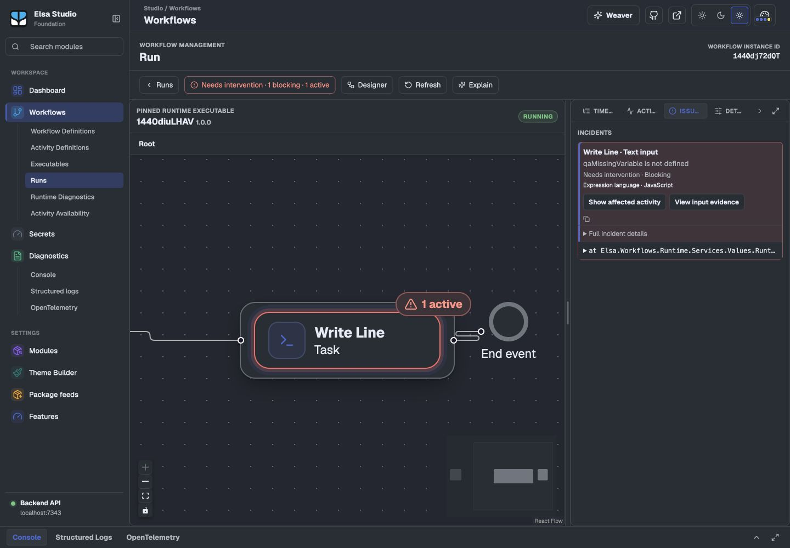

# Building Elsa 4 · Week 22: Keeping Secrets Out of Workflow State

*October 2–8, 2026*

Last week we rehearsed loading a new activity package into a running host. This week we looked at what the activity accepts and what a workflow should remember about the values it used. An activity needs the credential to do its job. The published executable and the diagnostic record only need enough information to describe how that credential was supplied. [Secret binding compilation](https://github.com/elsa-workflows/elsa-foundation/pull/2306), [Runtime resolution](https://github.com/elsa-workflows/elsa-foundation/pull/2307)

## Resolve the reference when the activity runs

A Secret binding compiles to a reference and a conversion plan. The persisted executable carries that withheld binding, while the running activity resolves it for the executing tenant and hydrates the value in memory. Activity authors can declare an input sensitive or mark it as a credential, which requires a Secret binding. The publication checks and Studio's editor use the same declarations. [Secret binding compilation](https://github.com/elsa-workflows/elsa-foundation/pull/2306), [Runtime resolution](https://github.com/elsa-workflows/elsa-foundation/pull/2307), [Input declarations](https://github.com/elsa-workflows/elsa-foundation/pull/2319), [Studio credential editor](https://github.com/elsa-workflows/elsa-foundation-studio/pull/548)

For a credential input, Studio offers the Secret picker. For sensitive text, it shows that a value is set and lets an authorized author replace it without prefilling the value in the field. Studio also learned to inspect a node using its exact pinned activity version. That's important after an activity adds an input: a workflow pinned to the newer version needs the newer descriptor even when the old activity version is still available. [Masked editor](https://github.com/elsa-workflows/elsa-foundation-studio/pull/548), [Pinned activity descriptors](https://github.com/elsa-workflows/elsa-foundation-studio/pull/547)

## Make a failed input easier to find

An input evaluation incident can leave the activity scheduled and the workflow running. That is confusing if the run list shows only the lifecycle state. Studio now surfaces run health and links incidents to the affected occurrence and input. If a failed child is inside a collapsed container, the container can show that a child needs attention while keeping its own execution status. [Incident navigation](https://github.com/elsa-workflows/elsa-foundation-studio/pull/556)

*In the October 4 browser verification, selecting the incident cue opens Issues beside the affected BPMN task.*

## Follow a source change all the way to a run

We also wrote contributor exercises around two small changes you can see for yourself. The Foundation exercise changes the output of Write Line, takes a focused test from failing to passing, and verifies the rebuilt result in a workflow. The Studio exercise follows a visible source change into the running UI, then publishes and inspects a workflow. Each guide records the environment used and restores the temporary edits at the end. [Foundation exercise](https://github.com/elsa-workflows/elsa-foundation/pull/2439), [Studio exercise](https://github.com/elsa-workflows/elsa-foundation-studio/pull/584)

Those exercises still lived in two repositories. The following week brought the backend and Studio source together, which changed where contributors would start. [Repository consolidation](https://github.com/elsa-workflows/elsa-foundation/pull/2644)
