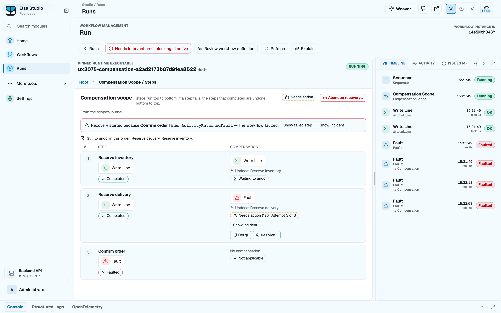

# Building Elsa 4 · Week 24: Undoing Work Across a Process Restart

*October 16–22, 2026*

Last week we changed when a workflow commits. This week we put those boundaries under pressure with native compensation. Say a workflow reserves two resources and then fails. It needs to release them in reverse order, and the workflow host itself can fail while doing that. It also needs enough durable information to distinguish a failed request from a request whose response was lost. [Restart proof](https://github.com/elsa-workflows/elsa-foundation/pull/3089), [Uncertain effects](https://github.com/elsa-workflows/elsa-foundation/pull/3117)

## A compensation attempt has an identity

The first end-to-end test used a real Workbench process. It killed the host after a compensation handler performed its effect and before the completion committed. On restart, the handler ran again with the same invocation ID. In the test, the participant recognized the repeat, each effect landed once, the handlers ran newest first, and the scope reached `Compensated`. The repeat depends on a participant that records and honors the operation key, as the sample reservation and release activities do. [Workbench recovery test](https://github.com/elsa-workflows/elsa-foundation/pull/3089), [Participant sample](https://github.com/elsa-workflows/elsa-foundation/pull/3163)

A forward step can also report an unknown outcome. The scope records it as uncertain and can attempt compensation using the forward step's key. If the handler exhausts its configured attempts, or an uncertain step has no handler, the scope can wait for a decision. We added delayed retries so a temporarily unavailable participant has time to come back before the scope runs out of attempts. [Uncertainty and retry policy](https://github.com/elsa-workflows/elsa-foundation/pull/3117), [Retry backoff](https://github.com/elsa-workflows/elsa-foundation/pull/3152)

## Sometimes an operator knows more than the runtime

Studio now reads the compensation journal and uses it to show what needs attention. For an operator with permission, the options include retrying, resolving an effect after checking the participant, or abandoning the recovery. The journal records the decision. Nested scopes, repeated scopes, and explicit confirmation make it possible to say when a group of effects is still eligible for undo. [Scope nesting and confirmation](https://github.com/elsa-workflows/elsa-foundation/pull/3126), [Operator actions and journal](https://github.com/elsa-workflows/elsa-foundation/pull/3136), [Studio recovery controls](https://github.com/elsa-workflows/elsa-foundation/pull/3140)

*An October 25 follow-up capture shows the undo order and the operator’s choices after the delivery handler exhausts its attempts.*

The runnable sample covers completed recoveries and an uncertain effect that an operator resolves as absent. It gives extension authors something concrete to run when implementing their own participant and deciding what they can promise on a repeated call. [Compensation sample and qualification record](https://github.com/elsa-workflows/elsa-foundation/pull/3163)

## A Flowchart starts where the event entered

Week 19 gave authors control over the ordinary Flowchart start node. This week, a run started by a trigger can begin at the trigger that actually fired. Publication also checks that a nested start trigger sits on a valid entry path, so Studio can refuse a graph whose structure would send the run to the wrong branch. This is part of preserving multi-trigger Flowcharts when importing from Elsa 3. [Trigger-aware Flowchart starts](https://github.com/elsa-workflows/elsa-foundation/pull/2856)
