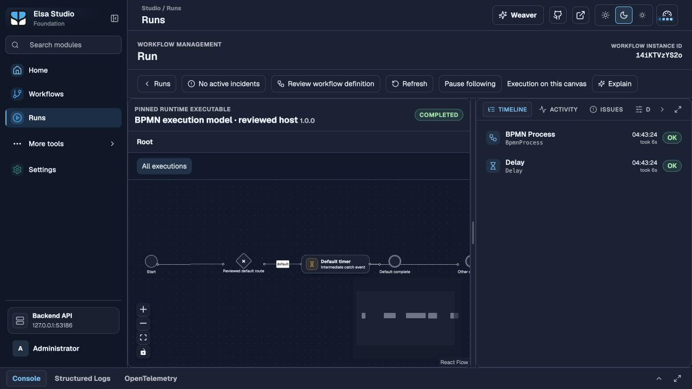

# Building Elsa 4 · Week 25: Taking Studio and BPMN Across Package Boundaries

*October 23–29, 2026*

Last week we exercised compensation through a real host restart. This week we put two other boundaries to work. A custom .NET host should be able to serve Studio from packages, and Elsa should be able to adopt a shared BPMN interpreter while preserving the state its own host already wrote. The interesting work was in proving each package boundary from the consuming side. [Packaged Studio](https://github.com/elsa-workflows/elsa-foundation/pull/3385), [Shared BPMN adoption](https://github.com/elsa-workflows/elsa-foundation/pull/3338)

## A custom host can serve Studio from NuGet

`Elsa.Studio.Hosting` took ownership of the prebuilt browser application through Razor static web assets. A custom host can restore and publish the standard `/studio` payload without building the frontend in its own source tree. Administration for features and packages can be composed separately through `Elsa.Studio.Hosting.Nuplane`. That lets a host add Studio and still decide which administrative capabilities it exposes. [Browser asset packaging](https://github.com/elsa-workflows/elsa-foundation/pull/3385), [Optional administration](https://github.com/elsa-workflows/elsa-foundation/pull/3386)

A page rendering is a weak test of what actually shipped. The qualification also built and published an external consumer from the candidate packages, hid the source and feed inputs, and exercised the resulting application. Deliberately omitting a dependency or a browser asset tested whether the check could detect the kind of broken package a consumer might receive. [NuGet consumer qualification](https://github.com/elsa-workflows/elsa-foundation/pull/3391)

## The BPMN library takes over the semantics

The shared BPMN project we introduced in August now runs through the Elsa Foundation host adapter. Elsa adopted version 0.5.0 of Bpmn.Model, Bpmn.Semantics, and Bpmn.Interchange and removed the embedded interpreter and its duplicate pruning rules. Elsa still owns how runtime commands are applied and persisted. Compatibility was checked with execution state captured from the previous writer and with retained authoring and export journeys in Studio. ADR 0063 was accepted after that verification. [Library adoption and retained state](https://github.com/elsa-workflows/elsa-foundation/pull/3338), [ADR acceptance and evidence](https://github.com/elsa-workflows/elsa-foundation/pull/3409)

*The BPMN adoption verification opened a completed run in Studio and inspected its timeline beside the process graph.*

The integrations work used another kind of package boundary. The first Integrations SDK made a common home for connector authoring, credential inputs, and authenticated HTTP connections. The first Slack and Microsoft 365 connectors share the HTTP connection and OAuth2 model, with the installer supplying their own app registration. [Integrations SDK](https://github.com/elsa-workflows/elsa-foundation/pull/2825), [Slack connector](https://github.com/elsa-workflows/elsa-foundation/pull/3324), [Microsoft 365 connector](https://github.com/elsa-workflows/elsa-foundation/pull/3332)

And if you were already working in the designer, there was a smaller change you could use right away. A Test Run attaches to the editor canvas. Choose an activity to inspect its recorded run data beside its design-time configuration. For a repeated activity you can select the particular execution you want to inspect. [Test Run inspection](https://github.com/elsa-workflows/elsa-foundation/pull/3401)
