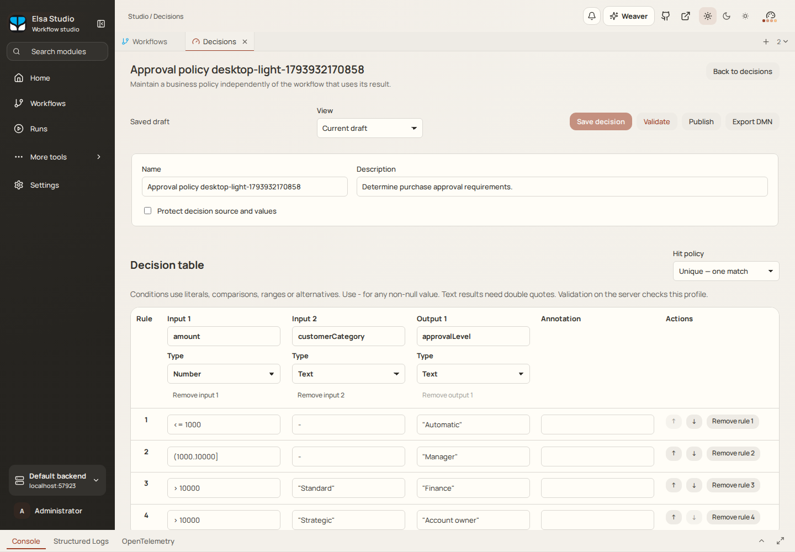
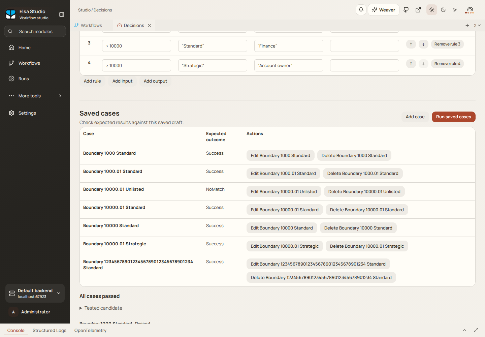
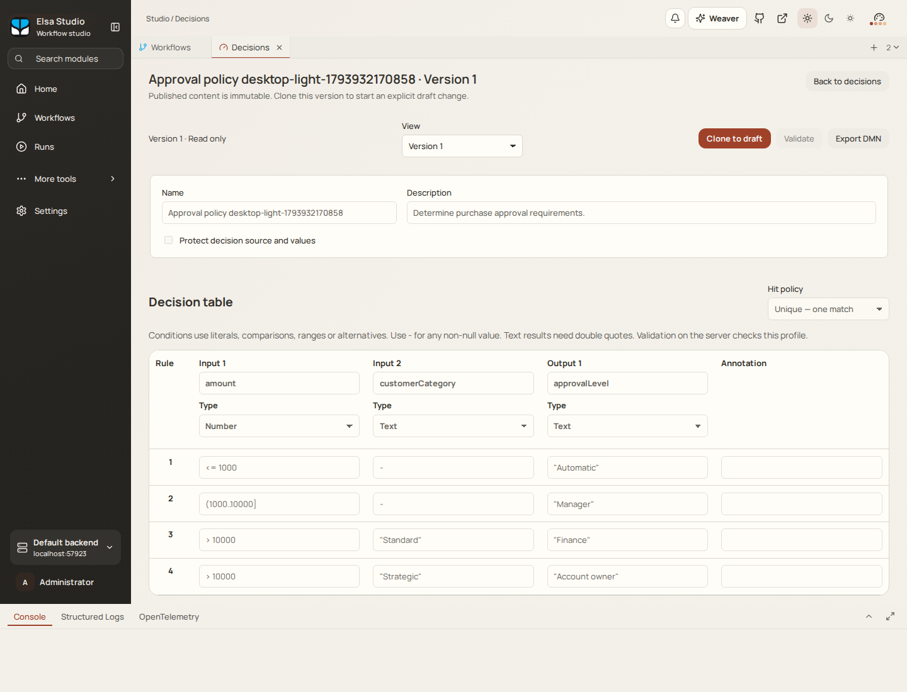
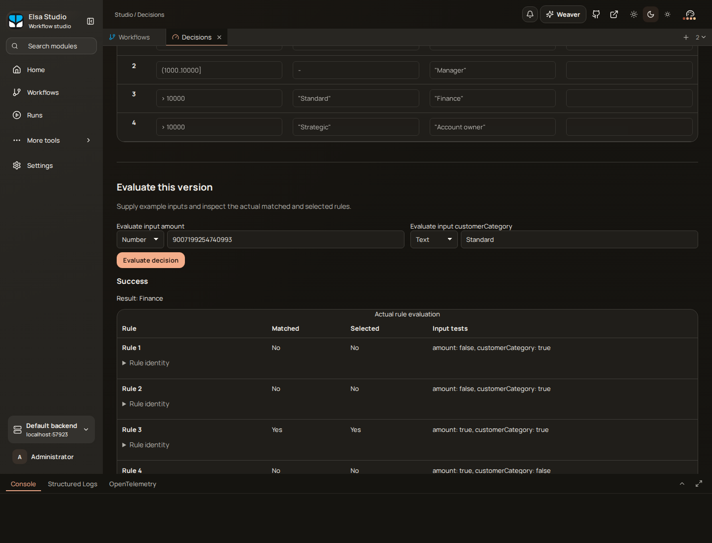

# Business rules in Elsa 4: introducing Decisions

A purchase needs approval. Below a certain amount, it can go through automatically. Above that, a manager needs to look at it. Larger purchases go to Finance, unless the customer is strategic, in which case the account owner gets involved.

You can put all of that in a workflow. Add a few conditions, connect the branches, and carry on.

Then another workflow needs the same policy. Someone changes a threshold. A third process has copied an older version. The question “why did this purchase go to Finance?” now involves finding the right branch in the right workflow.

This is the kind of problem the new **Decisions module** in Elsa 4 is meant to address. It gives business policies a home of their own: reusable decision tables that you can author, test, publish and call from a workflow.

The implementation has [landed in Elsa Foundation](https://github.com/elsa-workflows/elsa-foundation/pull/3689), including native workflow and BPMN integration. Elsa 4 remains preview software; this is a look at a capability taking shape, rather than a stable-release announcement.

## Give the policy its own table

Our purchase policy has two inputs, `amount` and `customerCategory`, and one output, `approvalLevel`. Written as a table, it looks like this:

| Purchase amount | Customer category | Approval level |
| --- | --- | --- |
| Up to 1,000 | Any non-null category | Automatic |
| Above 1,000, up to 10,000 | Any non-null category | Manager |
| Above 10,000 | Standard | Finance |
| Above 10,000 | Strategic | Account owner |

The table answers a specific question. It doesn't create an approval task or send a notification. Those actions belong to the process that uses its answer.

In Studio, you can create a named decision, define its input and output types, and edit the rules directly in the table.

*The approval policy in Studio. These screenshots come from the implementation's Studio qualification run, using sample data.*

Conditions can use comparisons and ranges. Here, `(1000..10000]` means greater than 1,000 and up to and including 10,000. Text results use quoted values such as `"Manager"`.

There's also a **hit policy**, which defines what should happen when rules match. This example uses Unique: one matching rule is allowed. If an edit creates an overlap and two rules match, evaluation reports a violation. It doesn't quietly choose whichever row happened to come first.

That makes the policy easier to discuss. You can review the thresholds and categories together, without following the surrounding process through every branch.

## Test the awkward boundaries

The interesting cases usually sit right on a boundary. What happens at exactly 1,000? At 1,000.01? What if a large purchase has a customer category the table doesn't cover?

Studio lets you save cases with inputs and expected results, then run them against a saved draft. The sample includes the threshold boundaries, both customer categories, and an unlisted category that should produce no match.

*Saved cases make the policy's expected behavior explicit, including the situations where no rule should match.*

Change a threshold and rerun those cases. If an expected result changes, you have something concrete to investigate before publishing. A test run also records the candidate it tested, so later edits don't rewrite what that earlier result means.

This is useful even when the table is small. A handful of examples can capture assumptions that would otherwise live in a conversation or a ticket.

## Put the decision inside a process

In an Elsa-native workflow, the **EvaluateDecision** activity supplies inputs to a published decision and returns its result and rule trace. You can use it from a Sequence or Flowchart, then use the returned data to choose the next step.

For our purchase example, the process might receive a request, collect the relevant customer information, evaluate the approval policy, and route the request to the appropriate approval path. The workflow owns the waiting, notifications, integrations and subsequent actions.

BPMN can use the same decision through a task bound to the EvaluateDecision activity. A gateway can then route on the returned approval level. This is already implemented: the [integration evidence](https://github.com/elsa-workflows/elsa-foundation/blob/fcbdc634e0d9e04e44491b6c29fde8d35c8b414d/specs/1195-business-decisions/evidence/execution-receipt.json) records matching results and selected-rule traces for native, Flowchart and BPMN callers.

There is a boundary here: the BPMN integration uses Elsa's task binding. It does not automatically interpret another vendor's `decisionRef` extension when importing a BPMN file.

The same policy can therefore serve processes with different shapes. A purchasing workflow and a BPMN renewal process can each use the decision without maintaining separate copies of its rules.

There's a [standalone .NET evaluator](https://github.com/elsa-workflows/elsa-foundation/blob/fcbdc634e0d9e04e44491b6c29fde8d35c8b414d/Extensions/Decisions/src/Elsa.Decisions/README.md), too. Its core doesn't require a workflow engine, database, web host or Studio. That leaves room to use the supported decision semantics in ordinary application code as well.

## Keep the version that was published

Separating a policy from a workflow introduces an important question: which version will the workflow use?

Decisions have editable drafts and immutable published versions. When a workflow is published, Elsa resolves its decision selection and embeds the selected decision in the executable artifact. A selection of “latest” is resolved at publication time.

It doesn't mean “fetch whatever is latest each time this running workflow reaches the activity.”

*A published decision is immutable. Further changes belong to a new draft.*

That matters for a process that waits for hours or days. Editing a policy while the process is waiting shouldn't silently change the decision it was published to use. The [workflow adapters](https://github.com/elsa-workflows/elsa-foundation/blob/fcbdc634e0d9e04e44491b6c29fde8d35c8b414d/Extensions/Decisions/src/Workflows/Design/README.md) freeze that dependency, while execution uses the workflow runtime's existing checkpoint, retry and recovery mechanisms.

To adopt an updated policy, you publish a workflow executable that selects the new version. Reuse stays deliberate.

## See why a rule was selected

Returning `Finance` answers where the request should go. It doesn't explain why.

Evaluation also returns the actual rule trace: which input tests matched, which rows matched, and which rules were selected under the hit policy. Studio displays that explanation alongside the result.

*Rule 3 produced Finance. The unusually large input in this development example also exercises exact numeric handling.*

The distinction between matched and selected matters for policies such as First, where several rows may match but only the first supplies the result. The explanation reflects the evaluator's work.

For a support engineer or policy owner, that gives a much better starting point than a final value on its own. They can inspect the relevant decision version and the rule that produced the answer.

## DMN, with a defined scope

The tables use **Decision Model and Notation**, or [DMN](https://www.omg.org/dmn/), the OMG standard for describing business decisions. DMN complements process modeling: a process describes how work progresses, while a decision model can express the policy used at a particular step.

Elsa currently implements a [bounded DMN 1.3 decision-table profile](https://github.com/elsa-workflows/elsa-foundation/blob/fcbdc634e0d9e04e44491b6c29fde8d35c8b414d/specs/1195-business-decisions/contracts/dmn-profile.md). It supports independent tables, typed scalar inputs and literal outputs, comparisons, ranges and alternatives. Supported hit policies are Unique, Any, First, Rule Order, and Collect without aggregation.

You can import and export DMN documents within that profile. Full FEEL expressions, dependent decision graphs and arbitrary vendor extensions are outside the executable scope. Unsupported semantics are refused explicitly; importing a document doesn't certify that every construct in it can run.

A naming detail if you've been following the repository: this capability lives in `Elsa.Decisions`. The existing `Elsa.Rules` module handles fact inference. They have different semantics and remain separate domains.

## Where this becomes useful

Purchase approvals are one example. The same approach fits other policies that map a known set of inputs to a result:

- **Customer onboarding:** choose a review level from customer type, country classification and a supplied risk score.
- **Order handling:** return a discount band or fulfillment priority from order value and customer category.
- **Claims processing:** select the required review route from claim amount and claim type.
- **Support intake:** determine an escalation level from severity and service tier.

In each case, the application or workflow gathers the inputs and acts on the result. The decision table keeps the policy visible and reusable.

That's what interests me about this addition to Elsa. Enterprise processes accumulate policies, exceptions and long waits. Being able to review a policy, test its boundaries, publish an immutable version and inspect its actual evaluation gives teams practical tools for managing that complexity.

In [A look at Elsa 4](/blog/a-look-at-elsa-4), I described the direction of bringing different kinds of work into the same platform. Decisions makes another part of that direction concrete. You can keep a process understandable while giving its business rules the attention they deserve.

If you're evaluating Elsa 4, try a policy that already appears in more than one of your processes. A small approval or routing table is a good place to see whether this separation would help your application.
