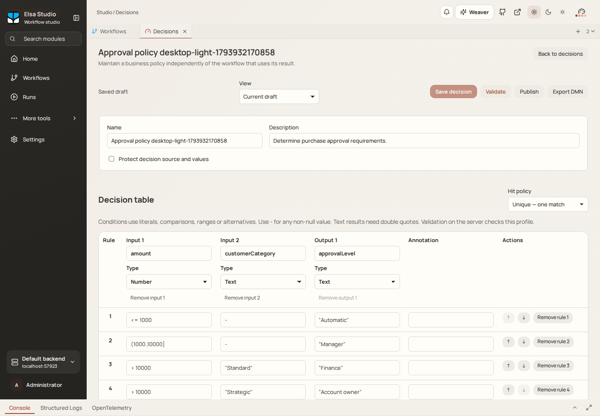

# Building Elsa 4 · Week 27: Choosing Where Workflow Data Comes From

*November 6–12, 2026*

Last week we gave Weaver a precise view of what you were editing or inspecting. This week we made a different kind of context explicit. When one activity needs the result of another, Studio should be able to show which result you can use and why. The publisher should reach the same answer if someone submits that binding outside Studio. [Shared data-source analysis](https://github.com/elsa-workflows/elsa-foundation/pull/3948), [Studio output chooser](https://github.com/elsa-workflows/elsa-foundation/pull/4073)

## Choose the output in the editor

On an eligible activity input, **Choose data** lists outputs from earlier activities and explains when a source is unavailable. Choosing one stores a reference validated by the server, with an option to navigate to the producer from the input. You can, for example, bind the whole result of an earlier step without declaring a workflow variable just to pass the value along. [Whole-output selection](https://github.com/elsa-workflows/elsa-foundation/pull/4073)

This needed a common analysis path. The server now checks source eligibility for discovery, validation, and executable publication, including references supplied through other authoring paths. We also landed backend support for reading members of an activity result or variable behind the off-by-default `MemberReads` setting. The documented rollout calls for upgrading every runtime that shares the store before enabling it. The whole-output chooser is the Studio change we can point to for this week. [Analysis and publication checks](https://github.com/elsa-workflows/elsa-foundation/pull/3948), [Activity-result member reads](https://github.com/elsa-workflows/elsa-foundation/pull/4165), [Variable member reads](https://github.com/elsa-workflows/elsa-foundation/pull/4180)

## An empty field should stay empty

The [Decisions article](/blog/business-rules-in-elsa-4-introducing-decisions) shows how to move an approval policy into a reusable table. This week's Studio work addressed the moment you connect that table to a workflow. The guided **Evaluate Decision** editor uses the selected table's input clauses so you can enter an amount or customer category without writing tagged JSON. Fields stay unset until you enter or confirm a value. In an approval table, a missing amount, an explicit zero, and an empty text value can all have different meanings. [Guided Decision inputs](https://github.com/elsa-workflows/elsa-foundation/pull/3994)

*These input clauses in the sample approval table determine the fields shown by the guided Evaluate Decision editor.*

If you create a decision from the picker's **New decision** action, Studio selects it when you return to the workflow. That closes the round trip from needing a policy to adding the reference where it will run. [Decision picker handoff](https://github.com/elsa-workflows/elsa-foundation/pull/4111)

## Weaver and workflow agents get distinct names

We started using `Elsa.Weaver.*` for the Studio assistant and `Elsa.Agent.*` for authored agents that workflows can invoke. That is also a package change for people following preview source builds. The naming gives the interactive assistant and an agent used by a workflow different places to look for contracts and extensions. [Weaver package move](https://github.com/elsa-workflows/elsa-foundation/pull/4029), [Agent package move](https://github.com/elsa-workflows/elsa-foundation/pull/4045)
