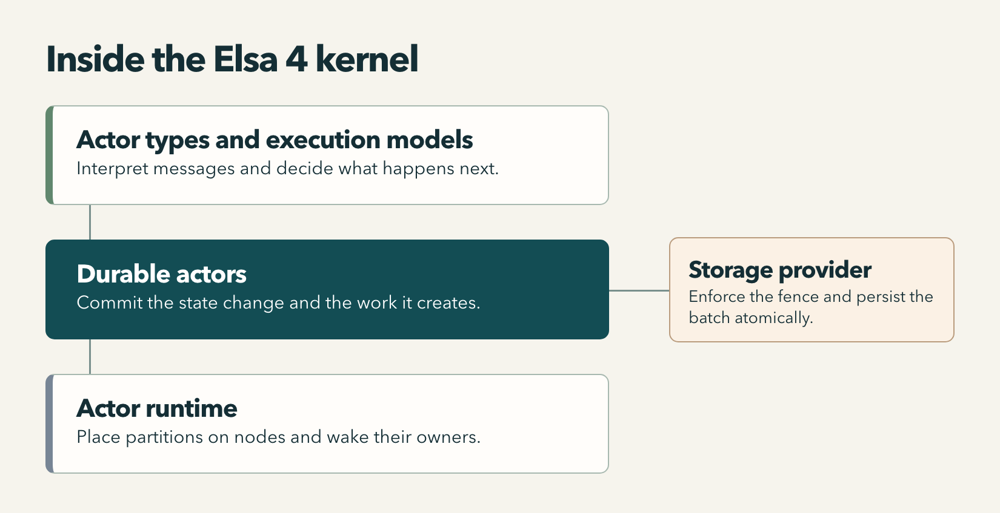

# Inside the Elsa 4 Kernel

Suppose an invoice workflow is waiting for approval. You click Approve. Later, I open the database and find both your approval and a workflow still waiting for it. What wakes it up?

An early version of our Elsa kernel prototype could get itself into exactly that state. Both writes succeeded. What we lost in a crash was the obligation to bring them together.

That problem gets at why we're redesigning the execution core for Elsa 4. The current preview already does careful work to make operations such as starting a child workflow recoverable. But even a simple sequence can take several trips through the scheduler and database to record that an activity was scheduled, started and completed, then hand control back to its parent. Adding another execution model means deciding how much of that machinery it has to adopt. We wanted to see how little machinery it takes to run a workflow *and* give a precise answer to what happens after a crash. The design is still a proposal. We've built a standalone prototype to test it before changing the product runtime. [Architecture and prototype status](https://github.com/elsa-workflows/elsa-foundation/tree/main/docs/architecture)

## Where a workflow fits

Start at the bottom. The **actor runtime** decides where work runs. An actor is something with its own state that processes one batch of messages at a time. The built-in runtime groups actors into partitions and assigns each partition to a node. One node can host many partitions, and one partition can hold many invoice workflows.

In the middle, **durable actors** give each instance an inbox and a way to commit a change to its state. A timer is a message due in the future. A background job has a durable ticket and returns its result as a message. The same layer checks whether the node doing the work still owns the partition. It can do all of this without knowing what an invoice is, or even what an activity is.

At the top, a **workflow instance** is one kind of actor. It knows its definition version, status, parent and children. Its **execution model** decides what an incoming message means. For a native Elsa sequence, finishing a child activity can mean scheduling the next one. For a BPMN interpreter, the question might be whether enough tokens have reached a gateway. Those are different rules for moving a workflow forward. Both can use the same inbox and commit.

## What happens when you click Approve

Take the ordinary case first. The workflow has committed its wait, and your approval matches it. The event router puts a message in the instance's inbox. A wake-up nudges the owner to run it promptly. If that signal gets lost, the owner can still discover the message by polling.

The owner gives the execution model the message and the instance's state. Let's say the workflow records who approved the invoice, removes the wait and schedules a job to notify Accounting. That's one **turn**. Several activities can run during it. When the turn ends, one transaction saves the updated state, consumes the input, removes the subscription and writes the job ticket. With full history it also appends a journal entry for that instance commit. A separate process can build the run viewer's tables from the journal at its own pace.

Now return to the awkward case. Suppose the wait explicitly accepts approvals received shortly *before* it was registered. In the simulation, an event publisher checked for a matching wait just before the wait committed. It found nothing. The waiting workflow was supposed to check for retained events just after committing, but its node died first. On restart, both records were there. Nothing told the new owner to look.

The fix was small. In the same transaction that registers this kind of wait, the workflow sends itself a message to check for earlier events. If the node dies, its replacement finds that instruction in the inbox. If the publisher and the recovering owner both find the match, they derive the same delivery ID, so the approval changes the workflow's state once. The simulation can replay the original failure from a single seed. [Prototype findings, case F6](https://github.com/elsa-workflows/elsa-foundation/blob/39edf448e2eca8b1bba5624df643bf9680e9720d/prototypes/kernel-model/FINDINGS.md#f6-a-crash-between-a-subscribing-commit-and-its-read-of-events-loses-the-event-invariant-13-run)

## What if the old owner comes back?

Imagine node A pauses halfway through preparing that approval. Its lease expires, node B takes the partition, and A wakes up still convinced it's responsible. A lease tells B when it may take over. Elsa also needs a way to reject the write A already prepared.

Every successful takeover increments a number called the **epoch**. In the prototype, a commit checks the epoch and the expected journal position inside the transaction that writes the batch. If B took over first, A's old epoch fails the check and the whole transaction rolls back. If A committed first, B recovers the state A actually saved. Even when the database connection drops just as A sends its commit, the recovery rule holds. The worker discards its in-memory assumptions, takes ownership afresh and reads what landed. [Ownership and fencing](https://github.com/elsa-workflows/elsa-foundation/blob/main/docs/architecture/ownership-and-fencing.md)

There's an important limit here for activity authors. The notification job can send an email and crash before it records success. Recovery can run it again. The database fence protects the workflow's state. An external service that must apply an operation only once needs to recognize a stable idempotency key, or give the activity a way to check what happened before retrying.

## What it costs to remember progress

Once an owner has an instance in memory, it can run several activities without reading the instance back between them. The workflow's persistence mode determines how much progress it saves along the way. We measured the difference on PostgreSQL 17.11 with a workflow of ten no-op activities, started on the node that already owned its partition, with full history configured.

| Persistence mode | What happened in this run | Driver commands | Transaction commits |
| --- | --- | ---: | ---: |
| Ephemeral | Finished in memory without waiting | 0 | 0 |
| Balanced | Ran all ten activities and saved at completion | 1 | 1 |
| Durable | Saved after each activity | 10 | 10 |

For a short HTTP workflow, Ephemeral can produce a response without a database call if it finishes in memory. A process crash can lose that run. Balanced saves at a durable wait or completion, so activities since the last checkpoint may run again. Durable shortens that replay window at the cost of more writes. The choice belongs to the workflow author, independently of which database the operator deploys.

Partitioning also lets several instances share a transaction. In a separate burst of 100 Balanced instances on one owner, one driver command and one commit persisted all 100. Those counts describe foreground database work. Polling, lease renewal, writing larger state and projecting history all carry costs of their own. To predict requests per second for an application, we'd need its actual workflows, payloads and concurrency. [Recorded cost cases](https://github.com/elsa-workflows/elsa-foundation/blob/39edf448e2eca8b1bba5624df643bf9680e9720d/prototypes/kernel-model/measurements/write-cost-2026-11-14/cost-cases.jsonl)

## What you can replace

If you already run **Orleans**, you can see the hosting boundary in the prototype's reference adapter. It hosts each partition as a grain. Orleans handles placement and wake-ups. The same Elsa durable layer still checks ownership and commits the turns. The runtime conformance suite exercises both hosts, including what happens when ownership changes. The proposed first release focuses on the built-in Embedded and Cluster profiles. Shipping an Orleans adapter depends on demand.

If you need a **different store**, the provider has to implement operations such as claiming ownership, delivering messages in order and atomically committing a fenced batch. The prototype has EF Core implementations for PostgreSQL, SQL Server, MySQL and SQLite, and a MongoDB implementation that uses transactions on a replica set. Providers can make different choices about how to satisfy the contract. For example, the SQL Server prototype checks the fence first because batching it later produced a deadlock during takeover. A store conformance suite lets an implementer test those choices. [Storage model](https://github.com/elsa-workflows/elsa-foundation/blob/main/docs/architecture/storage-model.md)

A replicated-log provider is a future design question that brings both boundaries into play. A partition leader could supply ownership and a log append could supply the commit. Where a provider can't write across two partitions in one transaction, the agreed rule allows it to record a send with the sender's commit and deliver it later using the message's stable ID. That's a useful test of the abstraction even before anyone builds that provider.

Finally, you can **add behavior**. An ordinary custom activity belongs in the native workflow model. A new interpreter with its own idea of state and progress belongs behind the execution-model contract. That's where we're exploring BPMN. A durable entity that holds a value and handles commands could instead be its own actor type. None of these needs to implement crash recovery for itself. [Prototype components and conformance suites](https://github.com/elsa-workflows/elsa-foundation/tree/main/prototypes/kernel-model)

If you'd like to see these pieces move, step through an approval or a takeover in the interactive walkthrough. Watch the inbox at the moment the owner disappears. The new owner can finish the job because the previous one wrote down what it still owed. [Explore the kernel walkthrough](https://vowful-mustard-pd8t.here.now/)
