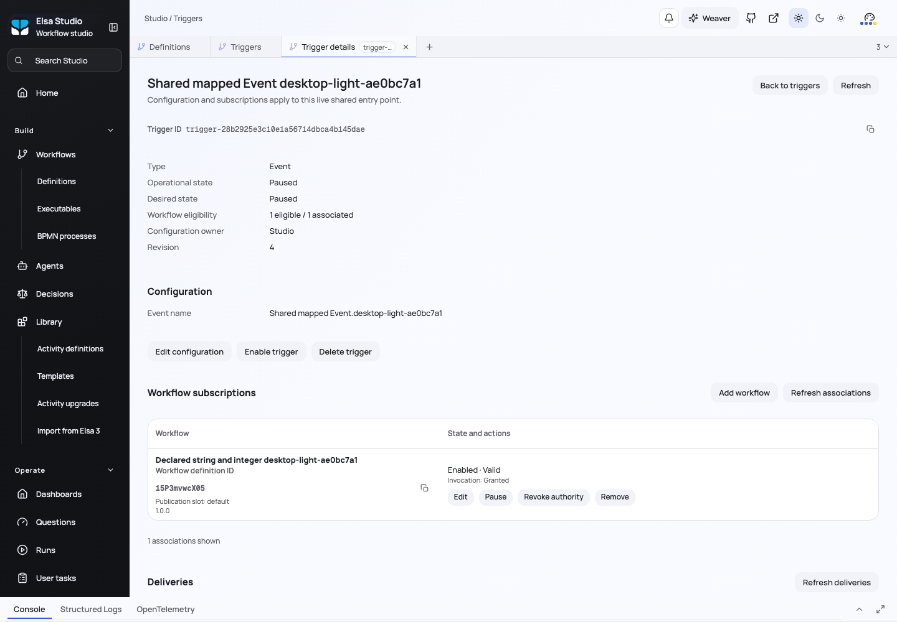
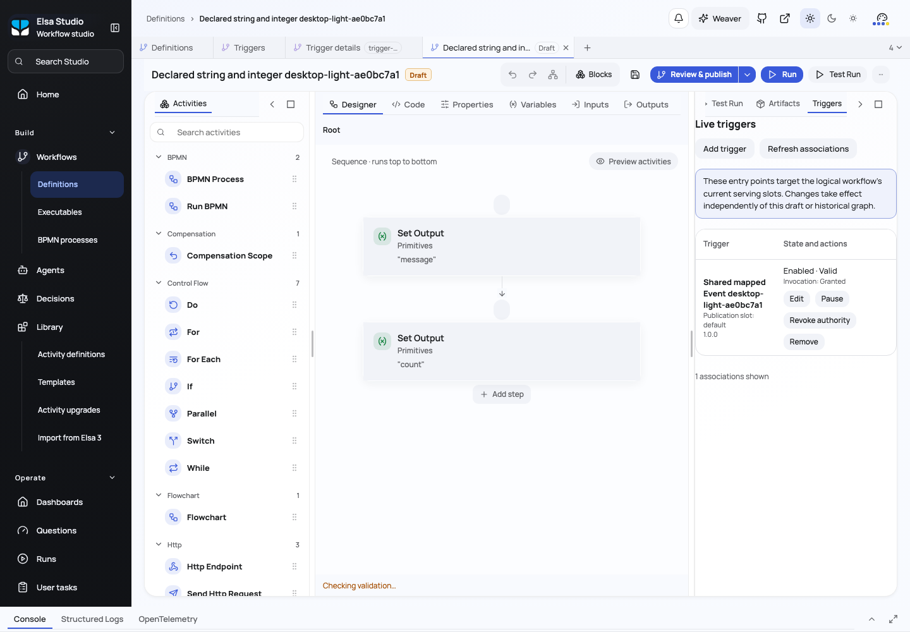

# Building Elsa 4 · Week 29: Giving Shared Triggers a Home of Their Own

*November 20–23, 2026 · partial week*

In Week 24 a Flowchart learned to enter at the trigger that fired. This week we finished a complementary feature in the existing Elsa 4 preview runtime. A trigger can be a resource you manage apart from any one workflow. That gives a shared event or schedule a place to live while the workflows that respond to it change independently. The clean-slate kernel also continued its separate recovery work. [Flowchart entry points](https://github.com/elsa-workflows/elsa-foundation/pull/2856), [Standalone trigger delivery](https://github.com/elsa-workflows/elsa-foundation/pull/4585)

## Subscribe a workflow to a shared trigger

A standalone trigger can be an **Event**, **HTTP**, **Timer**, or **Cron** resource. In Studio, you can manage it under **Operate → Triggers** and add workflow subscriptions, or edit those same live associations from the workflow editor. Each association follows a publication slot and maps its declared inputs. You can change which workflows respond to a shared trigger without saving or publishing their graphs. Graph-owned triggers remain available when the trigger belongs with the authored workflow. [Studio integration](https://github.com/elsa-workflows/elsa-foundation/pull/4580), [Standalone trigger guide](https://github.com/elsa-workflows/elsa-foundation/blob/ee53e40901/docs/standalone-triggers.md)

*Trigger details show the shared event and the publication slot selected by its subscription.*

*The workflow editor exposes the same live subscription in its Triggers tab. Both captures come from the November 22 verification.*

For example, one recurring trigger could start two published workflows, each with its own input mapping. If you look at delivery later, Studio distinguishes a dispatch that was committed from an execution it actually observed. A planned run ID can exist before a worker has started the run. For extension authors, the delivery includes public contracts for trigger metadata, validation, and ingress, and an optional custom Studio editor. [Delivery evidence model](https://github.com/elsa-workflows/elsa-foundation/pull/4580), [Separately built extension consumers](https://github.com/elsa-workflows/elsa-foundation/pull/4582)

This is an opt-in host composition. The recorded local qualification ran seven composed journeys across seven Studio appearances, for 49 passing cases. It covered real Event, Timer, Cron and HTTP behavior, restart recovery, BPMN worker inputs, and extension and access boundaries. Hosted CI and independent review were waived for this merge. The delivery record describes the qualified profiles and the separate resulting-main checks. [Composed qualification](https://github.com/elsa-workflows/elsa-foundation/pull/4584), [Delivery and verification record](https://github.com/elsa-workflows/elsa-foundation/blob/ee53e40901/specs/1217-standalone-triggers/evidence/delivery-2026-11-22.md)

## Resume a parked actor after ownership changes

In the kernel prototype, the in-memory foundation milestone gained an acceptance case for an inline actor that becomes durable, changes owners, and receives a termination before a timed job result can apply. It checks that termination wins and that another inline request can still complete. Provider and operational qualification belong to later milestones. [In-memory foundation acceptance](https://github.com/elsa-workflows/elsa-foundation/pull/4998)

The next recovery slices dealt with a parked actor's inbox. An input that arrived while the actor was parked can be eligible to resume it. An input already consumed by the turn that parked it calls for an explicit retry. The prototype now keeps those cases distinct and commits the recovery page cursor with its next control, so another owner can continue from the committed position. One November 23 test drove 510 retained arrivals across four pages and two owner changes and checked what happens when a page commit is lost. That evidence is from the in-memory worker. [Retained inputs](https://github.com/elsa-workflows/elsa-foundation/pull/5277), [Fenced recovery pages](https://github.com/elsa-workflows/elsa-foundation/pull/5366), [Resume and RetryAll checks](https://github.com/elsa-workflows/elsa-foundation/pull/5406), [Takeover test](https://github.com/elsa-workflows/elsa-foundation/pull/5459)
